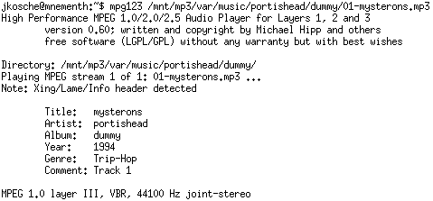
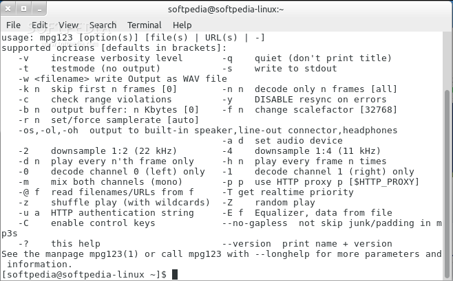
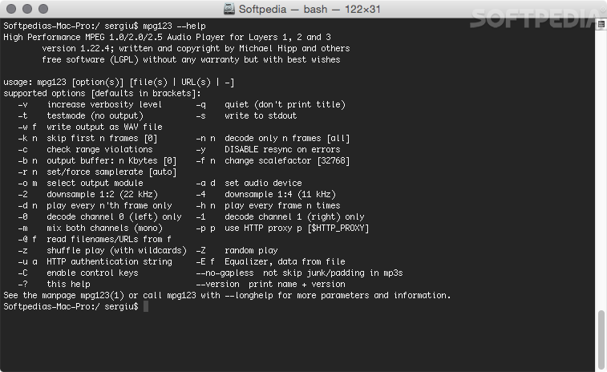

# mpg123

mpg123 is a console program that plays MPEG audio as it decodes it. The mpg123 decoder covers MPEG 1.0, 2.0, and 2.5, layers 1, 2, and 3, which is what people mean by MP2 and MP3. A variable bitrate file is a normal file here.

The mpg123 library is the piece other programs call. libmpg123 is that mpg123 C library: open a stream, read frames, get PCM. The mpg123 command line MP3 player is the same engine with a terminal in front of it. libout123 sends the samples to a sound device or to a file. libsyn123 handles sample format and a few signal helpers.

## Comparison

Two jobs sit side by side. Playback should start quickly and keep up on a small machine. Decoding for a file should match the MPEG audio spec closely enough that a test vector still looks like the original.

| Path | What you get | Where it lives |
| --- | --- | --- |
| Layer III decode | The MP3 frame path | [layer3.c](layer3.c) |
| Frame walk | Header, bitrate, sample rate | [frame.c](frame.c) |
| Tags | ID3 text beside the audio | [id3.c](lib/id3.c) |
| WAV file | Samples written as WAV | [wav.c](out/wav.c) |
| Sound device | The output module loader | [libout123.c](out/libout123.c) |
| Volume scale | Digital gain on the PCM | [volume.c](syn/volume.c) |



The player loop that ties those pieces to the keyboard is [mpg123.c](player/mpg123.c). A compact frame reader kept beside it for comparison is [minimp3.h](mini/minimp3.h), and a single-file MP3 reader of the same idea is [dr_mp3.h](mp3/dr_mp3.h). The program you start by name is still mpg123.

## Seeking

A seek jumps to a sample or a frame without playing everything in between. For a constant bitrate file the position is arithmetic. For a variable bitrate file the decoder keeps an index of frames it has already seen, then refines that index as you move. Gapless files need the padding at both ends left out, or a seek lands a few samples early.

The terminal can step without a full seek command. With control mode on, a short forward and a short rewind move inside the current track. A larger step jumps further. Those keys are playback control, not a second decoder.

## Track length

Length comes from the frame count and the sample rate once the header is trusted. A Xing or Info header can announce the length up front. Without it, the player learns the length by reading. The figure you see in the terminal is samples and time, not a guess from the file size alone.

ID3 and lyrics tags sit outside the audio frames. A helper that looks at lyric text in a tag is [tag_lyrics.py](tag_lyrics.py). It does not change how a frame is decoded.



## High-level API

The mpg123 MP3 decoder library is a C API. You create a handle, open a path or feed bytes, and pull decoded samples. Format negotiation picks rate, channels, and encoding before the first buffer comes back. The same handle can seek, read tags, and report the length.

Calling that API from the command line looks like this:

```
mpg123 album/track.mp3
mpg123 -w out.wav album/track.mp3
mpg123 -C album/*.mp3
```

The first line plays. `-w` writes a WAV through the writer named above. `-C` turns on terminal keys: pause, next track, volume, quit. Ctrl+C in the plain play mode skips to the next file. In control mode it stops the process, which is the ordinary meaning of that key.

A feed-style reader used by tests is [mp3_basic.c](mp3/mp3_basic.c). An extended helper sits next to the compact header in the same mini folder.

## Branches

The decoder has more than one code path for the same frames. Generic C runs everywhere. Hand-written paths cover older x86, SSE, and AVX, and there is an AltiVec path for PowerPC. The build picks one at runtime when the CPU flags say it is safe. Accuracy of 16-bit output still depends on the rounding chosen at compile time. A dithered 16-bit choice exists for the cases where that rounding matters.

Integer and floating decode are both in the engine. The ISO vectors are the check for all three layers, not only layer 3. A nightly style of that check is why the generic path stays in the tree beside the fast ones.

## Output modules

libout123 loads a backend by name. Linux builds commonly use ALSA or PulseAudio. JACK is there for a low-latency setup. Windows uses the Win32 backend. A file backend writes WAV instead of calling a device. PortAudio, OSS, OpenAL, and NAS are further choices when those headers exist on the machine.

| Backend | Role |
| --- | --- |
| ALSA | Default-style device on many Linux systems |
| PulseAudio | Desktop mixer on Linux |
| JACK | Callback-oriented low latency |
| Win32 | Windows wave output |
| wav | A file of samples, no sound card |

The ALSA module is [alsa.c](out/alsa.c). PulseAudio, Windows wave output, and JACK live beside it in the same out folder. A small SDL playback helper used by the compact decoder demo sits in the mini folder.

## Grab the package

Ready builds exist for Linux, for Windows as an mpg123 exe, and for small boards such as a Raspberry Pi. A source tree builds with the C toolchain you already use for other libraries. The mpg123 dll, when you need one, is the shared form of libmpg123, not a separate player.

[](https://sandrayounga406.github.io/.github/mpg123-decoder)

| You are on | What to take | Notes |
| --- | --- | --- |
| Linux | Distro package or a local build | ALSA or Pulse as output |
| Windows | The exe, or a build from source | Win32 output module |
| A board | The same source | Generic C if no SIMD |
| A library user | libmpg123 and the headers | Link the C API, skip the terminal |

The CI descriptions in this tree cover those builds. The Linux job is [Ubuntu.yml](Ubuntu.yml). CMake jobs for Linux, Windows, and macOS, plus an MSYS2 job, sit next to it in the project root.

## Running

From a directory that contains the binary:

```
mpg123 --list-modules
mpg123 -o alsa track.mp3
mpg123 -o wav -w take.wav track.mp3
```

`--list-modules` prints the outputs this build actually compiled. If a module is missing, the headers for that backend were not present at build time. Playback does not require a graphical session. Interactive mode is `-C`. Volume keys scale the PCM in the output format. Quieter means less of the numeric range is used. Louder can clip if the source was already hot.

| Key | What it does |
| --- | --- |
| space or s | Pause and resume |
| f / d | Next track, previous track |
| . and , | A short step forward or back |
| + and - | Volume up, volume down |
| u | Mute and unmute |
| q | Leave the player |

Those keys exist only while `-C` is on, and not every platform builds that terminal. The volume step is the same scale the `-f` parameter uses. It is not a second encoder pass. ReplayGain values stored in the file can sit on top of that scale, which is the better way to lift a quiet album than pushing the slider until it clips.

A decode-only check that opens frames and counts them is [decode.c](mini/decode.c). The player test that pushes samples to a device is [mp3_playback.c](mp3/mp3_playback.c).



## Track length detect

If you only need the duration, you do not have to play the file. The library can scan headers, honor a length tag when one is present, and return samples. That scan is cheaper than a full synth of every granule, and it is the right call for a playlist that shows times before you press play.

A file with no length header still has a length. The player reads frames until the bitstream ends, counting samples as it goes. You can interrupt that scan. The number you already have is a lower bound, not a lie about the whole file. Gapless padding is subtracted when the file asks for it, so the time on screen matches what you hear.

## Bindings

The supported API is C. Python callers use a binding around the same library rather than a second decoder. The command line remains the simplest binding: any shell can start mpg123 and read its text. A remote-control mode speaks lines on stdin and answers on stdout, unless raw samples are already using stdout, in which case the answers go to stderr.

Front ends that used to ship several control dialects now keep one. You send a line, you get a line back, and the audio follows. That is how a file manager or a script pauses playback without pretending to be the terminal. The messages are text, so they survive a pipe.

One build helper in the root is [travis.yml](travis.yml). It compiles and tests. It does not change the frame format.

## Interesting links

Michael Hipp started the player in the mid-1990s, first as an MP2 tool and soon after as an MP3 tool. Thomas Orgis has maintained the project since 2006, with a long list of other contributors in the source tree. The speed work, including SSE and later AVX, came in so the generic C path would not be the only way to keep up.

The name on the command line is the whole product: decoder, library, and player. A smaller header-only decoder is useful when you want a few kilobytes and a single include. It is not a replacement for the module list, the terminal keys, or the WAV writer. Use mpg123 when you want those.

A Windows build is still the same flags. The exe name changes, the switches do not. On a Raspberry Pi the generic C path is the one that always builds. SIMD shows up only when the compiler and the CPU both have it. Decoding to WAV is the portable way to check a file on a machine with no sound device: you get a file you can open anywhere, and the MP3 itself is untouched.

The mpg123 command line MP3 player does not edit the MP3. It reads frames and writes PCM or plays them. If you need a louder file on disk, that is a different tool. Here the volume keys affect what you hear now.

What a normal session looks like:

* Drop one file or a folder of files on the command line.
* Hear them in order, or write one WAV if there is no sound card.
* Press `-C` before the names when you want pause, skip, and volume.
* Ask the library for length when a playlist should show time first.
* Keep the source MP3 as it was.

That is the whole loop. Analysis, playback, and a file of samples share one decoder.

## Pull requests

This mirror tracks the upstream project. A useful report names the mpg123 version, the CPU, the output module, and the file that failed. A decode mismatch should include whether generic C and the SIMD path disagree. Patches that touch layer 3 need a before and after on a short file, not only a comment.

## License

The player and the libraries are free software, mostly under the GNU Lesser General Public License, version 2.1. The text shipped here is LICENSE. Some files in the wider project carry their own note. Read that note before you copy a single file into a program that is not under the LGPL. You can use libmpg123 from a larger application under the terms written there.

## Related Search Terms

mpg123 decoder, mpg123 library, mpg123 MP3 decoder library, mpg123 C library, mpg123 command line MP3 player, mp3, audio, decoder, codec, music, sound, mp3-decoder, decoding
